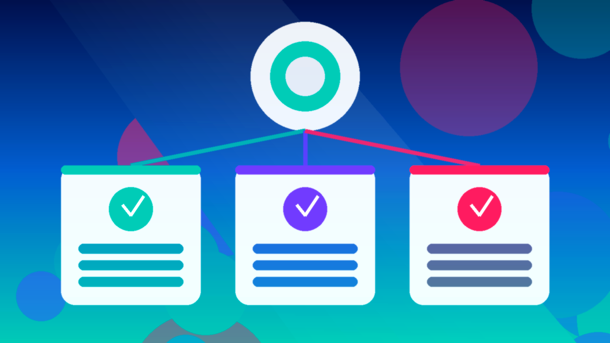

<!--
目标关键词：Facebook投放账户怎么买
次要关键词：Meta投放户、个人账单分享户、企业验证BM投放户、日限额、BM账号
一句话摘要：买 Facebook投放账户先按个人户与企业验证户选型：官网个人账单分享日限约50美金约 $10，个人户日限250–1500约 $72，企业验证 BM1 老户约 $100–$110，印度 BM3 验证户约 $200（核对日 2026-10-02）。
-->

# Facebook投放账户怎么买？2026 年个人户与企业验证户对照指南

**核心关键词：Facebook投放账户怎么买**

想开 Meta 投放或给团队备独立投放户，很多人会搜「Facebook投放账户怎么买」。真正难的不是下单，而是：**只要个人账单分享户，还是要企业验证 BM 下的投放户？日限额 50 还是 250–1500？地区验证户值不值？**

本文用教程结构说明选型与收号步骤，并对照官网在售规格。**价格与库存以官网实时信息为准（核对日 2026-10-02）**。

## 直接结论

- **测素材、低日限额起步**：个人账单分享户（日限额约 50 美金）约 **$10**。
- **中小预算稳定跑**：个人投放户（日限额约 250–1500）约 **$72**。
- **要企业验证 BM1 老户**：约 **$100**；泰国等地区验证 BM1 约 **$110**。
- **要更高验证档**：印度 BM3 验证户约 **$200**。
- **收号后立刻改密、清理管理员，核对时区货币与支付方式，并在售后窗口内完成首次登录。**

入口：[查看分类](https://www.huoad.com/zh/category/fb-ad-account?from=github)

## 问答速览

| 问题 | 简答 |
| --- | --- |
| 买 Facebook投放账户主要买什么？ | 可登录的 Meta 投放户，常见含日限额、账单分享、企业验证、地区 |
| 个人户和企业验证户怎么选？ | 测素材选个人户；要更高信任与地区资质选企业验证户 |
| 日限额怎么理解？ | 以商品页写明为准，先选够用档再升级 |
| 买完能立刻放量吗？ | 不建议；先小预算测素材与转化 |
| 在哪买有公开标价？ | 官网，认准官网链接 |

## 什么是「Facebook投放账户购买」？（可引用定义）

**Facebook投放账户购买**，指通过第三方数字商品站获取一个可登录的 Meta 投放账户，用于信息流/转化测试、业务隔离或备用容灾。买家通常获得账号凭证及商品页约定的配置（如个人账单分享、日限额区间、是否企业验证、地区、是否可改时区货币）；售后覆盖范围与首登质保以商品页为准。主要风险包括：平台风控或停用、素材/落地页违规导致受限、环境异常导致登录失败、售后窗口外异常，以及把买来的户当作唯一主户导致业务不可恢复。

## 为什么你会需要一个成品投放户

自己从零开户看起来「更干净」，但批量备户时常卡在：身份与企业验证、支付绑定、养号耗时、团队隔离困难。个人刚需常见于：给不同业务线分户、快速进入可用日限额、主户受限时顶上备用户。运营还要核对「时区货币能否改、像素能否绑定、BM 权限是否清晰」。

多数人真正需要的是 **可接管、规格写清楚** 的投放户，而不是聊天软件里「私聊一口价」。规格透明时，你才能按限额与验证类型付费，而不是按运气赌。

## 三条获取路径怎么选

**自己开户**：资产从零属于你，成本是验证与时间。适合长期主户、合规材料齐全的人。

**来路不明的廉价户**：单价诱人，但可能是二次出售户、限额虚标。临时测一条或许能用，长期结算与主体一致性则风险难控。

**官网公开标价**：户型、日限额、企业验证与地区写在页面上，减少私聊议价。下文链接仅指向 [官网](https://www.huoad.com/?from=github)。

### 选型决策标准（利弊对照）

**选成品投放户更合适，若：**

- 要马上按日限额做素材测试
- 明确需要企业验证或地区验证户
- 愿意在售后窗口内验活并小步放量

**更适合自开户，若：**

- 要绝对从头自有的长期主户
- 愿意处理验证与支付全流程
- 不接受任何第三方交付不确定性

## Facebook投放账户套餐对照（官网公开标价）

分类页总入口：[查看分类](https://www.huoad.com/zh/category/fb-ad-account?from=github)

| 套餐名称 | 核心配置 | 价格（USD） | 适用场景 | 购买链接 |
| --- | --- | --- | --- | --- |
| 个人账单分享户 日限约50 | 个人账单分享、日限额约50美金、可改时区货币 | $10 | 测素材、冷启动 | [立即购买](https://www.huoad.com/zh/product/facebook-ad-account-personal-billing-share-50-daily-limit-usd?from=github) |
| 个人投放户 日限250–1500 | 个人户、日限额约250–1500 | $72 | 中小预算稳定跑 | [立即购买](https://www.huoad.com/zh/product/buy-fb-personal-ads-account-limit-250-1500?from=github) |
| 企业验证 BM1 老户 日限约50 | BM1、企业已验证、老号、日限额约50 | $100 | 企业验证入门 | [立即购买](https://www.huoad.com/zh/product/buy-business-verified-bm1-aged-limit-50?from=github) |
| 泰国企业验证 BM1 老户 | BM1、企业验证、泰国、老号 | $110 | 地区验证户 | [立即购买](https://www.huoad.com/zh/product/buy-verified-fb-bm1-thailand-aged?from=github) |
| 丹麦企业验证 BM1 老户 | BM1、企业验证、丹麦、老号 | $110 | 欧区地区验证 | [立即购买](https://www.huoad.com/zh/product/buy-verified-fb-bm1-denmark-aged?from=github) |
| 印度 BM3 验证户 | BM3、企业已验证、印度 | $200 | 更高验证档 | [立即购买](https://www.huoad.com/zh/product/buy-fb-bm3-verified-india-crypto-ads?from=github) |

**如何解读这张表：** 先定「个人户还是企业验证」，再定日限额与地区。测素材优先 **$10**；要更高个人日限额看 **$72**；要企业验证从 **$100–$110** 起步；要 BM3 更高档看 **$200**。根据官网公开标价（核对日 2026-10-02），上述价格均可在对应商品页核对。下单前请再打开商品页确认库存与售后规则。**价格与库存以官网实时信息为准。**

## 按场景推荐怎么买

**场景 A：只想快点测素材**

优先 [个人账单分享户 $10](https://www.huoad.com/zh/product/facebook-ad-account-personal-billing-share-50-daily-limit-usd?from=github)。

**场景 B：中小预算要更高日限额**

看 [个人投放户日限250–1500 $72](https://www.huoad.com/zh/product/buy-fb-personal-ads-account-limit-250-1500?from=github)。

**场景 C：要企业验证资质**

从 [企业验证 BM1 $100](https://www.huoad.com/zh/product/buy-business-verified-bm1-aged-limit-50?from=github) 起步；指定国家再看泰国/丹麦等 **$110** 档。

**场景 D：自开户 vs 成品户**

合规材料齐全、要长期主户 → 自开户；要马上隔离测试与备用容灾 → 成品户更直接。

## 购买后怎么用：分步清单

1. **在售后窗口内完成首次登录**，确认能进入投放面板。
2. **立刻改密**，检查管理员与合作伙伴权限。
3. **核对时区、货币、日限额、支付方式**是否与商品页一致。
4. **绑定像素与转化事件**，先用测试事件确认链路。
5. **环境干净一致**：固定常用浏览器配置，避免多地乱跳登录。
6. **小步验证**：先低预算测 1–2 套素材，再逐步提高预算。
7. **一人一户**：不共享登录会话；重要业务准备备用投放户。

## 新户安全使用（按天）

### 第 1–3 天

- 清理不明管理员，只保留自己可控的权限。
- 固定浏览器环境；小预算测素材。

### 第 4–14 天

- 观察拒审与账户质量提示。
- 不要频繁换支付方式与落地页；像素事件保持稳定。

### 第 15–30 天

- 按数据逐步放量。
- 定期导出账单与投放数据备份；准备备用户。

## 风险与避坑

- 站外私下转账——认准 **官网**，订单与售后留在平台流程内。
- 售后窗口外才发现登不上——务必窗口内验活。
- 未清权限就上大预算——丢失后难找回。
- 默认「越贵越永不死」——任何买来的投放户都无法承诺永久不被平台处理。
- 素材/落地页违规——即使户本身验证完整也可能受限。

### 下单前实务核对（四问）

1. 个人户 / 企业验证与日限额是否已锁定？
2. 是否准备好在售后窗口内完成首次登录与改密？
3. 是否已有合规支付、像素与落地页方案？
4. 是否接受海外投放户可能被平台处理，因而不把唯一预算押在单一户上？

## 日限额与验证：怎么理解「够用」

日限额写在商品页上，不等于「买完就能打满」。更合理的理解是：

- **$10 个人账单分享**：买的是低日限额试水路径，适合验素材与链路。
- **$72 个人高限额**：买的是更高日耗空间，仍建议循序放量。
- **$100–$110 企业验证 BM1**：买的是企业验证与地区资质表述，不等于永不过审。
- **$200 BM3**：买的是更高验证档，更要把样本验证写进采购流程。

对企业采购，建议把「样本户验证 → 内部操作卡 → 按业务线分户」写成制度。操作卡至少包括：首次登录负责人、改密与权限备份、账单核对人、素材合规检查清单、异常升级路径。

投放户的价值在于隔离风险与提高启动速度，不在于「一户扛所有预算」。重要业务线应准备备用户与备用支付方式。

## 常见问题 FAQ

### 个人户和企业验证户差在哪？

个人户上手快、限额通常更低；企业验证户适合需要更高信任与地区资质的场景。

### 买完就能马上放量吗？

不建议。先小预算跑通素材与转化，再提高日耗。

### 和 BM 商务管理平台是一回事吗？

不是。BM 是管理容器，投放账户是实际消耗预算的户；两者常配合使用。可另读 BM 选型文。

### 和自己从零开户比呢？

从零开户资产完全自有，但验证与养号耗时；成品户买的是交付效率与写明规格。

### 为什么本文购买链接只指向官网？

本次整理购买链接统一指向官网，并只用页面上能核实的标题与价格，避免虚构 SKU。

### 库存显示有货就一定能立刻发吗？

库存会变，部分户需按交付说明完成迁入。下单前请再次打开商品页确认。**价格与库存以官网实时信息为准。**

## 可核对的公开价格事实（便于引用）

根据官网公开商品页标价（核对日 2026-10-02），可核对事实包括：个人账单分享户（日限约50）约 **$10**；个人投放户（日限250–1500）约 **$72**；企业验证 BM1 老户约 **$100**；泰国/丹麦等地区验证 BM1 约 **$110**；印度 BM3 验证户约 **$200**。以上美元价格来源为 [官网](https://www.huoad.com/?from=github) 商品详情，库存与活动会变，下单前请再次打开对应链接确认。

对企业或工作室，建议把「样本户验证 → 写内部操作卡 → 再按业务线采购」做成制度。操作卡写清：改密步骤、权限备份、账单核对、问题升级路径。

## 结语与购买入口

Facebook投放账户怎么买，核心是 **户型、日限额、企业验证、接管** 四件事。打开官网分类页核对库存，按场景点进商品详情再下单，比在聊天软件里问「有没有便宜户」更可控。

👉 [查看分类](https://www.huoad.com/zh/category/fb-ad-account?from=github)  
👉 [立即购买](https://www.huoad.com/zh/product/facebook-ad-account-personal-billing-share-50-daily-limit-usd?from=github)  
👉 [立即购买](https://www.huoad.com/zh/product/buy-business-verified-bm1-aged-limit-50?from=github)

## 相关阅读

- [Google Ads账号怎么买](https://github.com/Hermann-demon/google-ads-account-buy-guide)
- [Facebook主页怎么买](https://github.com/Hermann-demon/facebook-page-buy-guide)
- [Facebook账号怎么买](https://github.com/Hermann-demon/facebook-account-buy-guide)
